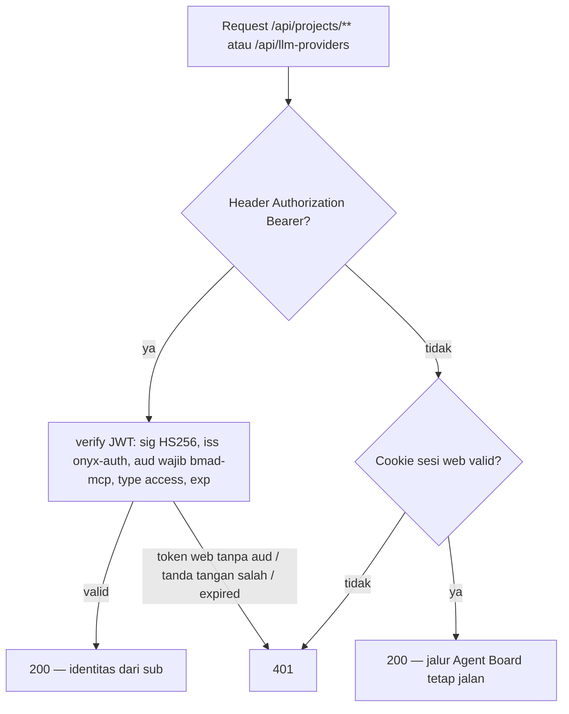

# architecture-diagrams.md — Diagram alur OAuth PKCE BMad Monitor MCP

## 1. Login PKCE end-to-end (CAP-1 + CAP-2)

```mermaid
sequenceDiagram
    participant CLI as bmad-monitor (Go)
    participant B as Browser user
    participant W as Dashboard web
    participant L as Loopback 127.0.0.1:<port>

    CLI->>CLI: generate verifier, S256 challenge, state; buka listener bebas
    CLI->>B: buka /oauth/authorize?response_type=code&client_id=bmad-mcp-cli&redirect_uri&state&code_challenge&code_challenge_method=S256
    B->>W: GET /oauth/authorize
    alt tanpa sesi web
        W-->>B: 302 /login?next=<authorize-url>
        B->>W: login (flow web existing)
        W-->>B: kembali ke /oauth/authorize
    end
    alt status != Active
        W-->>B: halaman pesan allowance (tanpa code, tanpa redirect)
    else Active
        W-->>B: halaman persetujuan (auth-shell)
        B->>W: klik Authorize
        W->>W: INSERT oauth_codes (code, code_challenge, redirect_uri, user_id, expires_at +60s)
        W-->>L: 302 <redirect_uri>?code=...&state=...
        L-->>CLI: code (state sudah dicek klien)
        CLI->>W: POST /api/oauth/token (authorization_code + code_verifier)
        W->>W: konsumsi code atomik → cek redirect_uri → cek PKCE S256 → cek status Active
        W-->>CLI: 200 { access_token (JWT aud=bmad-mcp), refresh_token, expires_in, user.isAllowed }
        CLI->>CLI: simpan ~/.bmad-monitor
    end
```

## 2. Grant refresh_token (CAP-3)

```mermaid
sequenceDiagram
    participant CLI as bmad-monitor (Go)
    participant W as Dashboard web

    CLI->>W: POST /api/oauth/token (grant_type=refresh_token, client_id, refresh_token)
    W->>W: verify JWT refresh (sig, iss, exp, jti)
    W->>W: UPDATE oauth_refresh_tokens SET revoked_at='rotated' WHERE token_hash=sha256(jti) AND revoked_at IS NULL RETURNING
    alt klaim berhasil
        W->>W: muat user; status Active?
        alt Active
            W-->>CLI: 200 pasangan token baru + user (rotasi)
        else non-Active
            W->>W: revoke semua token MCP user
            W-->>CLI: 403 access_denied
        end
    else klaim gagal (replay)
        W->>W: klasifikasi revoked_reason: dalam grace → issue baru; lewat grace / logout → revoke keluarga
        W-->>CLI: 400 invalid_grant
    end
```

## 3. Verifikasi Bearer di REST BMad (CAP-4)


