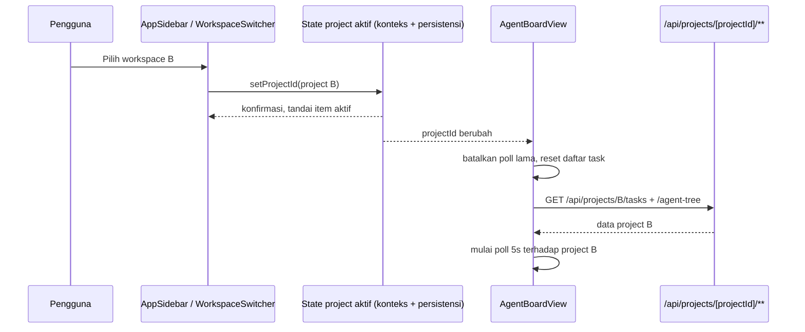
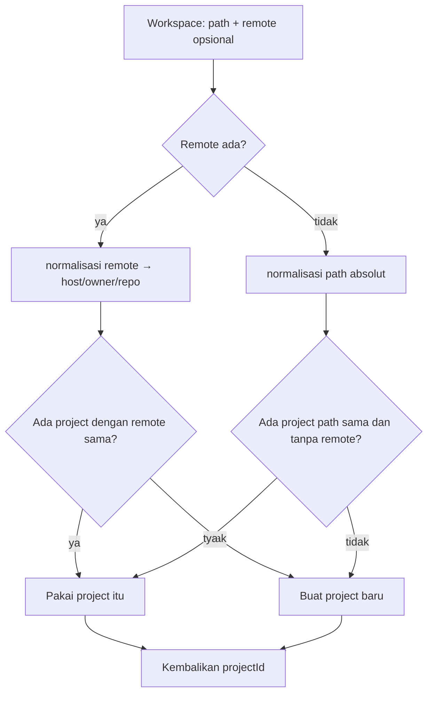
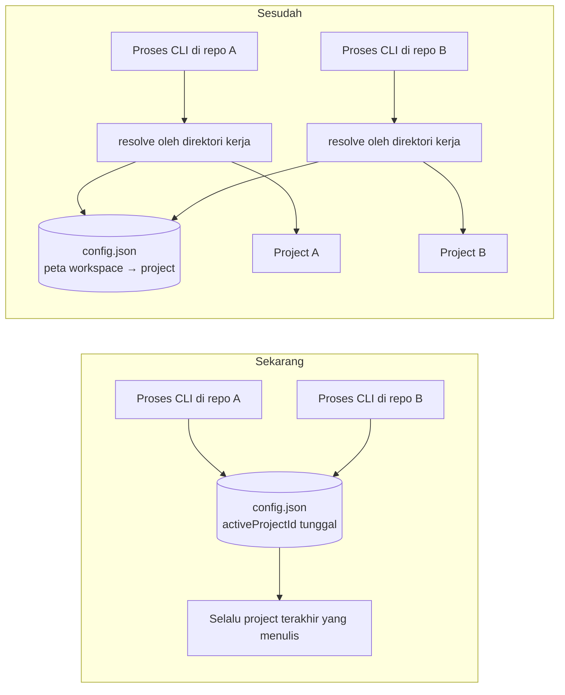

# architecture-diagrams.md — Alur resolusi dan scoping

## 1. Alur pemilihan workspace di web

Kunci: penanda item aktif di sidebar dan sumber data di board berasal dari satu keadaan yang sama. Tidak boleh ada dua sumber kebenaran.

## 2. Resolusi identitas (get-or-create)

Pemeriksaan `D` dan `H` harus berada di dalam satu transaksi atau dilindungi unique index, agar dua sesi paralel tidak sama-sama lolos ke `F`.

## 3. Sebelum dan sesudah, sisi CLI

## 4. Batas tanggung jawab

| Lapisan | Tahu tentang | Tidak tahu tentang |
|---|---|---|
| Sidebar / switcher | daftar project, project terpilih | cara task dimuat |
| AgentBoardView | project terpilih, siklus polling | cara identitas workspace dihitung |
| API `/api/projects/[projectId]/**` | `projectId` dari path | siapa penggunanya, workspace mana asalnya |
| Resolusi identitas | remote/path → project (get-or-create) | UI, tampilan |
| CLI state | direktori kerja → `projectId` | isi board |
